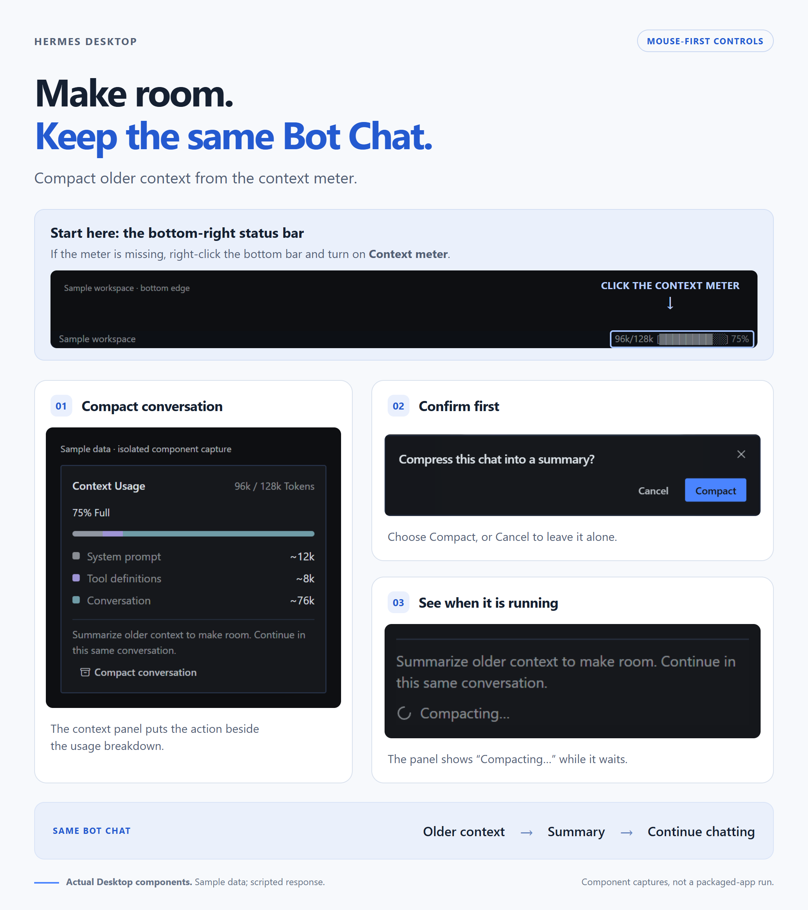
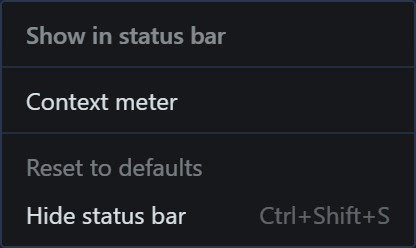
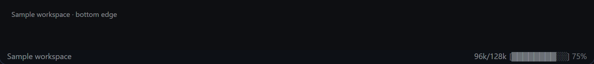
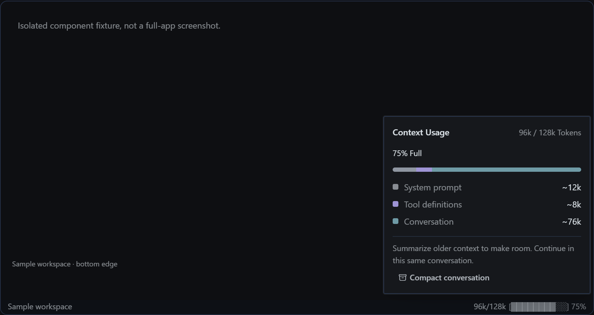
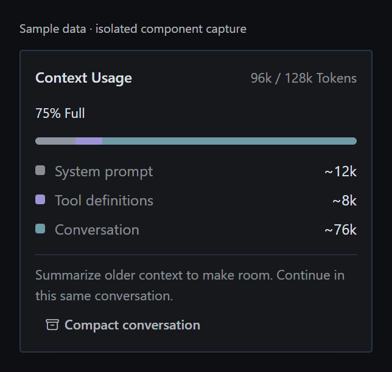
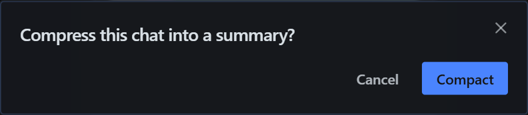
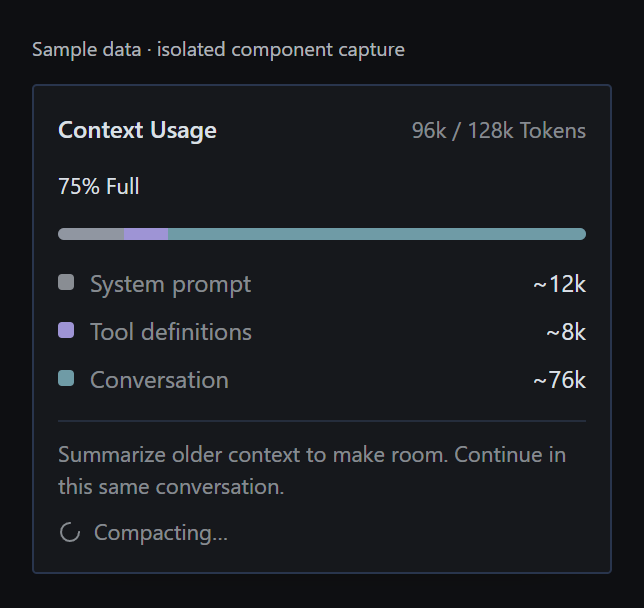

# Compact conversation: review media

The infographic uses actual Desktop component captures. All token counts are sample values. The compaction response is scripted. These are isolated Chromium component captures, not packaged-app screenshots or real-model acceptance evidence.

## Where to open it

1. Right-click the status bar along the bottom of the Desktop window.
2. Under Show in status bar, enable Context meter. It is hidden by default.
3. Click the context/token readout at the right end of the bar.
4. Select Compact conversation, then Compact.

The meter uses the existing bottom bar, alongside version and usage indicators. This feature adds an action inside its context panel; it does not add a separate bar.

## Images

## Provenance

The status bar and popover are real Desktop components. The surrounding location fixture is illustrative and is not the full Desktop window. No live account or chat data was used. Image versions are pinned to the separate asset commit referenced in the pull-request body, so the validated source head is unchanged.
